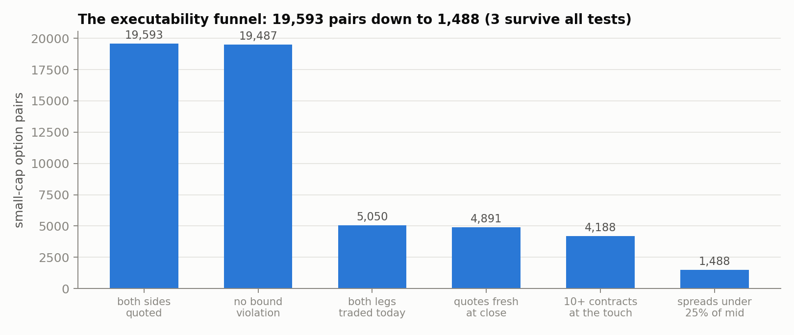
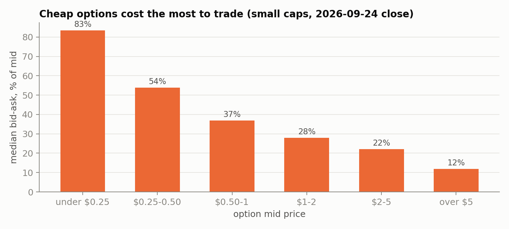

# Put-Call Parity Arbitrage Scan

Can a stock hedged with options lock in a profit in every outcome? The only structure that pays the same in every state is the conversion (long 100 shares, long a put, short a call, same strike and expiry), and it beats cash only when

```
K * e^(-rT) + PV(dividends)  >  S_ask + P_ask - C_bid + fees
```

which is a put-call parity violation net of costs. This scans 40,733 option pairs for it.

Research code. It places no orders and is not financial advice.

## Data

| | |
|---|---|
| Snapshot | 2026-09-24 close |
| Universe | 294 optionable stocks priced $0.50 to $20, plus 12 large-cap controls |
| Pairs | 40,733 (expiry, strike) pairs with both a call and a put quoted |
| Quotes | Alpaca's free indicative options feed |
| Rates | US Treasury daily curve |

## Results

**Calibration.** On the liquid controls, conversions earn 2.12% and reversals cost 6.74% against a 4.20% Treasury rate, which is the right ordering (lend below, borrow above), so the arithmetic checks out.

**The funnel.** Filters are on executability only (trades today, fresh quotes, size at the touch, spreads), never on the size of the edge:

| Small caps | Pairs | Conversions above zero |
|---|---|---|
| both sides quoted | 19,593 | 391 |
| after all five filters | 1,488 | 20 |
| also positive with no dividends and one tick of slippage | | **3** |

The three survivors pay $0.10 to $0.43 per contract on about $1,300 of capital each.



| Survivor | Expiry | Strike | Capital | Profit | After one tick |
|---|---|---|---|---|---|
| SOFI | 2026-11-20 | 13.0 | $1,289 | $2.43 | $0.43 |
| NOK | 2026-10-09 | 10.5 | $1,046 | $2.37 | $0.37 |
| SOFI | 2027-09-17 | 17.0 | $1,625 | $2.10 | $0.10 |

**Dividend traps.** Each conversion is priced once assuming every projected dividend arrives and once assuming none does, because an in-the-money short call is exercised early precisely to collect the dividend. The best-looking trades were the worst: CPB goes from +$21.56 to -$55.97 and AGNC from +$1.92 to -$69.37 under early assignment.

**Why there is nothing there:**

- options under $1 have a median spread of 56% of the mid;
- an at-the-money put costs about three times as much on a small cap as on a large cap;
- apparent reversal profit in hard-to-borrow names is the borrow fee, which the options already price in;
- 93.7% of small-cap pairs break parity at mid prices, but only 2.0% do at executable prices.



| At-the-money put, % of share price | Large caps | Small caps |
|---|---|---|
| under 2 weeks | 1.0% | 3.2% |
| 2 to 5 weeks | 2.0% | 6.5% |
| 5 to 11 weeks | 2.7% | 9.4% |
| 11 to 29 weeks | 4.9% | 14.1% |

| Carry implied by the options, liquid near-the-money pairs | Median | 90th percentile |
|---|---|---|
| large caps, easy to borrow | -0.6% | 1.5% |
| small caps, easy to borrow | -0.7% | 8.4% |
| small caps, hard to borrow | 6.8% | 51.7% |

**The large-cap survivors** (`financing.py`). 142 control pairs survive, mostly long-dated and in the money. They are a loan, not an arbitrage. A conversion earns an interest rate, and on these names it sits about 0.8 points above Treasuries where early exercise can't distort it. That is roughly $147 a year per contract more than a T-bill, on about $29,500 of capital.

**The collar frontier.** Keeping any upside on a hedged position costs guaranteed floor. SOFI, 2026-12-18 expiry, put at $17:

| Call strike | Upside kept | Cost | Guaranteed floor | Best case |
|---|---|---|---|---|
| 17 (the conversion) | 0.00 | 16.83 | +0.003 | +0.003 |
| 18 | 1.00 | 17.27 | -0.437 | +0.553 |
| 20 | 3.00 | 17.82 | -0.987 | +1.984 |
| 23 | 6.00 | 18.17 | -1.337 | +4.605 |

Only the zero-upside conversion has a positive floor, at about the T-bill rate.

**Sources of fake profit** that the filters had to remove: a stale daily bar read as today's volume, a flat 3-month rate applied to one-year options (worth about 44 basis points a year of false edge), dividends projected from irregular special payments, and mid prices treated as tradable.

## Limitations

- One snapshot, at the close, from an indicative feed rather than full OPRA quotes.
- The stock leg is modelled at a 5 basis point half-spread, and borrow costs are inferred from the options.
- Assignment fees, pin risk and margin are not modelled. Each would make the result worse.

## Running it

```bash
pip install -r requirements.txt
cp .env.example .env      # add Alpaca API keys (a free account works)
python universe.py && python fetch_chains.py
python scan.py            # calibration and funnel
python verdict.py         # dividend bracket, slippage, hedge cost, borrow, collar frontier
python financing.py       # the large-cap survivors as interest rates
python tests/test_parity.py
```

| File | What it does |
|---|---|
| `parity.py` | conversion and reversal economics at mid and executable prices |
| `scan.py`, `verdict.py`, `financing.py` | the scan and the analysis above |
| `hedge.py`, `hedge_report.py` | the collar frontier |
| `divs.py`, `curve.py` | dividend projection and the Treasury curve |
| `tests/test_parity.py` | 12 tests on the arithmetic and dividends |

Tested with Python 3.13.
